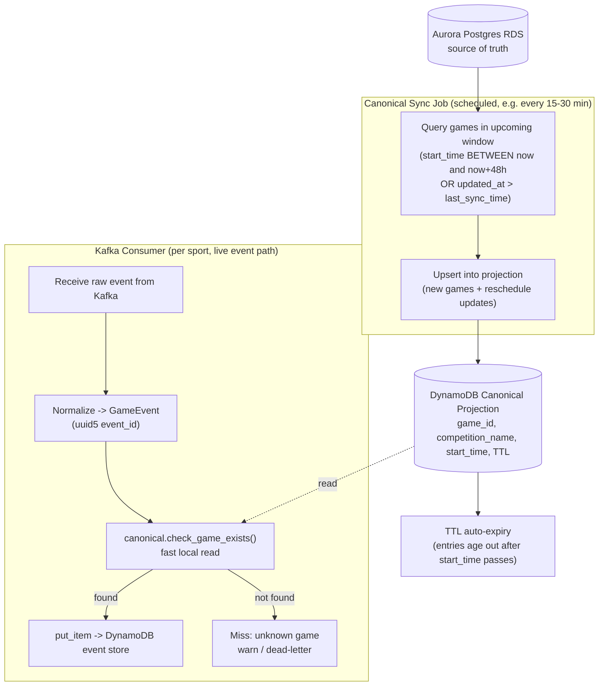

# LiveSportsData

A FastAPI-based service for live sports data.

## Project Structure

```
.
├── app/
│   ├── main.py              # FastAPI app instance and router registration
│   ├── api/
│   │   └── routes/          # API route modules (endpoints)
│   │       └── health.py
│   ├── core/
│   │   └── config.py        # App settings (env-based configuration)
│   ├── models/
│   │   └── keys.py          # PK/SK builders + uuid7() for the football table
│   ├── schemas/
│   │   └── football.py      # Pydantic models (Competition, Game, GameEvent, Team, ...)
│   ├── services/              # Business logic / external integrations
│   │   ├── dynamodb.py       # DynamoDB resource/client factory + table setup
│   │   └── football_repository.py  # Query helpers for the football access patterns
│   └── ingestion/              # Poll (raw) -> Kafka -> normalize -> canonical check -> DynamoDB
│       ├── providers/          # Provider-specific polling adapters (raw payloads only)
│       │   ├── base.py         # Provider protocol (sport, poll(), partition_key())
│       │   ├── sportsfeedx.py  # Football stub (nested JSON, ISO8601 timestamps)
│       │   ├── livescorecore.py # Football stub (flat JSON, epoch ms, event codes)
│       │   └── basketball_stub.py # Basketball stub ("HoopStream": flat JSON, action codes)
│       ├── normalizers/         # Pluggable provider -> GameEvent normalizer registry
│       │   ├── registry.py     # register()/normalize(); deterministic (uuid5) event_id
│       │   ├── football.py     # sportsfeedx/livescorecore/runner normalizers
│       │   └── basketball.py   # HoopStream normalizer
│       ├── canonical.py        # Mock canonical (Competition/Game) lookup used before persisting
│       ├── poller.py            # PollerService: polls providers, publishes RAW payloads to Kafka
│       ├── kafka_producer.py   # EventProducer: publishes raw envelopes, routed by sport/topic
│       ├── kafka_consumer.py   # EventConsumer: normalizes + persists per sport's topic
│       ├── run_poller.py        # Worker entrypoint: python -m app.ingestion.run_poller
│       └── run_consumer.py      # Worker entrypoint: python -m app.ingestion.run_consumer --sport {football,basketball}
├── tests/                    # Test suite
├── scripts/
│   ├── create_table.py       # Create the DynamoDB table (with GSI1/GSI2) locally
│   └── poc.sh                 # Start/stop/status for the whole POC (see Quick Start)
├── docker-compose.yml         # Local DynamoDB + Kafka services
├── pyproject.toml
├── README.md
└── README-dynamodb-vs-redis.md  # Why DynamoDB for ingest vs Redis for CDN JSON
```

## Requirements

- Python >= 3.9

## Setup

Install the project and its dependencies (including dev/test tools):

```bash
python3 -m pip install -e ".[dev]"
```

## Running the App

```bash
uvicorn app.main:app --reload
```

The API will be available at http://127.0.0.1:8000

- Interactive docs: http://127.0.0.1:8000/docs
- Health check: http://127.0.0.1:8000/api/health

## Quick Start: Start/Stop the Whole POC

`scripts/poc.sh` brings up (or tears down) every piece of the POC with one
command: DynamoDB Local + Kafka (via `docker compose`), table creation, the
FastAPI app, the provider poller (football + basketball), and one Kafka
consumer process per sport.

```bash
scripts/poc.sh start    # start everything
scripts/poc.sh status   # check what's running
scripts/poc.sh stop     # stop everything (processes + containers)
```

- The API listens on port **8080** by default (not 8000, since DynamoDB
  Local already occupies that port) — override with `API_PORT`, e.g.
  `API_PORT=9000 scripts/poc.sh start`.
- Once started:
  - Interactive docs: http://localhost:8080/docs
  - Health check: http://localhost:8080/api/health
  - Live monitor page: http://localhost:8080/api/competitions/BUNDESLIGA/games/demo-1/monitor
  - Ingestion monitor dashboard (Aurora + canonical projection + recent
    events across all games): http://localhost:8080/api/monitor
- **Runner endpoint** (`POST /api/runner/competitions/{competition_name}/games/{game_id}/events`,
  see `app/api/routes/runner.py`): manually triggers a scripted sequence of
  events for any competition/game, published to Kafka just like a real provider
  would be -- handy for demos/latency checks without waiting on the poller.
  Supports both sports via the request body's `sport` field (`FOOTBALL`,
  the default, or `BASKETBALL`), which selects the matching canned script
  (`_FOOTBALL_SCRIPT`/`_BASKETBALL_SCRIPT`) and default team names
  (Bayern/Dortmund vs. Lakers/Celtics) if `team_home`/`team_away` are
  omitted, e.g.:
  ```
  curl -X POST http://localhost:8080/api/runner/competitions/NBA/games/hps-3301/events \
    -H 'Content-Type: application/json' \
    -d '{"sport": "BASKETBALL", "delay_seconds": 0}'
  ```
  `GET /api/runner/runs/{run_id}` polls progress and
  `POST /api/runner/runs/{run_id}/stop` cancels an in-flight run.
- Each process (`api`, `poller`, `consumer-football`, `consumer-basketball`)
  is run in the background with its PID tracked under `.run/` and its
  output logged to `.run/logs/{api,poller,consumer-football,consumer-basketball}.log`.
- **Note**: don't run `python3 -m pytest` while the POC is running --
  the poller/consumer publish fixed demo events using the same game IDs
  the test suite uses, which can cause event-count assertions in
  `tests/test_ingestion_pipeline.py` to fail due to leftover/duplicate
  data in the shared local DynamoDB table. Run `scripts/poc.sh stop`
  first, or use `docker compose up -d` on its own (without starting the
  poller/consumer) when just running tests.

## Running Tests

```bash
python3 -m pytest
```

## Configuration

App settings are managed via `app/core/config.py` using `pydantic-settings`.
Environment variables can be set directly or via a `.env` file in the project root.

## DynamoDB (Local)

This project uses `boto3` to talk to DynamoDB, and can be pointed at either
real AWS DynamoDB or a local instance for development.

Why DynamoDB for ingest (vs Redis, including a separate ingest Redis cluster)
and how that sits next to serving Redis → CDN JSON is documented in
[README-dynamodb-vs-redis.md](README-dynamodb-vs-redis.md).

### Start DynamoDB Local

```bash
docker compose up -d dynamodb-local
```

This starts DynamoDB Local at `http://localhost:8000` with data persisted in
a Docker volume.

### Configuration

By default, `app/core/config.py` points at `http://localhost:8000` with dummy
credentials (DynamoDB Local does not validate credentials). Override via
environment variables or a `.env` file if needed:

```
DYNAMODB_ENDPOINT_URL=http://localhost:8000
AWS_REGION=us-east-1
AWS_ACCESS_KEY_ID=fakeMyKeyId
AWS_SECRET_ACCESS_KEY=fakeSecretAccessKey
```

To use real AWS DynamoDB, set `DYNAMODB_ENDPOINT_URL=` (empty) and provide
real AWS credentials (or rely on the default AWS credential chain).

### Usage in code

```python
from app.services.dynamodb import get_dynamodb_resource

dynamodb = get_dynamodb_resource()
table = dynamodb.Table("my-table")
```

### Stopping DynamoDB Local

```bash
docker compose down
```

## Football Data Model

Football data (competitions, games, events, teams, players) is stored in a single
DynamoDB table using a single-table design. The `PK` is prefixed with the
sport (`SPORT#{FOOTBALL|BASKETBALL}#...`, see `app/models/keys.py`) so the
same table layout extends to basketball; `app/services/football_repository.py`'s
query helpers each take a `sport` keyword argument (default `FOOTBALL`, for
backward compatibility) so the same access patterns below work for basketball
too -- pass `sport=keys.SPORT_BASKETBALL` to query basketball's partition.
`GET /api/competitions/{competition_name}/games/{game_id}/events` exposes this as a
`?sport=` query param (default `FOOTBALL`); `get_top_events` (GSI2-backed,
used by `/events/top` and the monitor page) needs no `sport` param since
GSI2 keys events purely by competition/game, not sport.

```
PK = SPORT#FOOTBALL#{COMPETITION_NAME}
SK = METADATA                                     (Competition)
   | GAMEID#{GAME_UUID}#METADATA                  (Game)
   | GAMEID#{GAME_UUID}#EVENT#{TYPE}#{UUIDv7}     (Game Event)
   | TEAM#{TEAM_NAME}                             (Team)
   | TEAM#{TEAM_NAME}#PLAYER#{PLAYER_NAME}        (Player)
   | TEAM#{TEAM_NAME}#GAME#{GAME_DATE}#{GAME_UUID} (Game<->Team index)

GSI1PK = TEAM#{TEAM_NAME}
GSI1SK = GAME#{GAME_DATE}#{GAME_UUID}             (games for a followed team)
       | EVENT#{TYPE}#{UUIDv7}                     (events for a followed team)

GSI2PK = GAME#{COMPETITION_NAME}#{GAME_UUID}
GSI2SK = INGESTEDAT#{TIMESTAMP}                    (events for a game, time-ordered)
```

### Why single-table design and key overloading

This model deliberately stores five different entity types (Competition, Game,
Game Event, Team, Player) plus a Game↔Team index item, all in **one**
DynamoDB table, distinguished only by the *shape* of their `PK`/`SK`
strings ("key overloading") rather than one table per entity type. That
trade-off is DynamoDB-idiomatic and buys several concrete benefits here:

- **Single-request hierarchical fetches.** Every item under a competition or
  game shares the same `PK` prefix (`SPORT#{sport}#{COMPETITION_NAME}`), so
  "get a competition and everything nested under it" is a single `Query` on
  `PK` with a `SK begins_with` condition, instead of N calls across N
  tables (competitions, games, events, teams, players) that the app would then
  have to join in code. `get_game_events`, `get_team`, etc. are each one
  bounded `Query`, not a fan-out of round trips.
- **Co-location for locality and cost.** Related items (a game and its
  events) live in the same partition, so DynamoDB serves them from the
  same physical storage node. A multi-table design achieves the
  equivalent "join" by issuing separate `GetItem`/`Query` calls per table
  and stitching results in application code — more round trips, more
  latency, and more RCUs for the same logical read.
- **One table to provision, scale, and operate.** A single table means
  one throughput/capacity setting, one set of GSIs, one backup/restore
  target, and one `create_table_if_not_exists()` bootstrap
  (`app/services/dynamodb.py`) — instead of five tables (or more, as
  entity types grow) each needing their own capacity planning, indexes,
  and lifecycle management. This is also why adding basketball required
  zero new tables: it's the same table, same key shapes, just a different
  `{sport}` prefix.
- **The overloaded `SK` prefix *is* the index.** Encoding entity type
  into the `SK` (`METADATA` vs. `GAMEID#...#EVENT#{TYPE}#{UUIDv7}` vs.
  `TEAM#{TEAM_NAME}#...`) lets one partition hold heterogeneous entity
  types while still supporting precise, targeted queries via
  `begins_with`/`between` conditions on `SK` — e.g. `get_events_by_type`
  and `get_events_in_range` filter *within* the partition using the `SK`
  structure alone, no full-partition scan or client-side filtering
  needed.
- **GSIs reuse the same overloading trick to add access patterns without
  new tables.** GSI1 (`TEAM#{TEAM_NAME}` partition) and GSI2
  (`GAME#{COMPETITION_NAME}#{GAME_UUID}` partition) are just alternate
  PK/SK projections over the *same* items — "follow a team across
  competitions" and "top-N recent events for a game" both become single
  bounded queries against an index, rather than requiring either a scan
  of the base table or a denormalized copy of the data in a second table.
- **The trade-off being accepted**: single-table design pushes complexity
  into the *key design* up front (as seen in the `PK`/`SK` grammar above)
  in exchange for fewer, cheaper, more predictable queries at read time.
  This is the standard DynamoDB modeling trade — optimize the schema for
  the known access patterns rather than for normalized-relational clarity
  — which is why `football_repository.py`'s access-pattern list (below)
  exists as the actual "schema contract" for this table, not an ERD.

- **Event ordering**: event sort keys embed a UUIDv7 timestamp, so events of
  the same type within a game/team sort chronologically. `app/models/keys.uuid7()`
  uses a monotonic counter to guarantee strict ordering even for multiple
  events generated within the same millisecond.
- **GSI1** supports "follow a team" access patterns (all games/events for a
  team across competitions) without scanning.
- **GSI2** supports `get_top_events` (most recent N events for a game,
  regardless of type) with a single bounded, reverse-sorted query instead of
  fetching every event for the game and sorting in Python.
- `app/services/football_repository.py` implements the access patterns:
  `get_competition`, `get_game`, `get_team`, `get_game_events`,
  `get_events_by_type`, `get_latest_event_by_type`, `get_events_in_range`,
  `get_games_for_team`, `get_events_for_team`, `get_top_events`.

Table creation (including GSI1/GSI2) is handled by
`app/services/dynamodb.create_table_if_not_exists()`. If the table already
exists but is missing a GSI (e.g. an older local table created before GSI2
was added), it's automatically back-filled in place via `UpdateTable` — no
manual table drop or `docker compose down -v` is required.

## Ingestion Pipeline

Scope for this POC: **ingest, normalize, and persist** live sports events
(football + basketball) with low latency. Fan-out to clients is handled by a
separate, existing system (DynamoDB → CDC → Kafka → CDN) that is out of
scope here — our job is to make sure normalized events land in DynamoDB
quickly and idempotently.

The pipeline is **raw-first**: providers' raw payloads are published to
Kafka as-is, and normalization happens downstream in the consumer. This
lets raw data be buffered/replayed and normalization logic evolve
independently of polling, and keeps the poller simple and provider-agnostic.

```
Provider APIs (poll)  →  Provider Adapters  →  Kafka topic(s)         →  Consumer (per sport)      →  DynamoDB
(SportsFeedX,             (raw payload,          {sport}.events,          normalize (registry)          (writes via
 LiveScoreCore,            partition key            partitioned by         → canonical check              football_repository,
 HoopStream, ...)          extraction only,         {competition}#{game_id}     → deterministic (uuid5)         PK=SPORT#{sport}#...)
                           no normalization)                                event_id assigned here)
```

### Why Kafka as a buffer

Providers are polled (not pushed via webhook), so each poll can surface a
batch of new events at once. Kafka decouples ingestion from persistence:
polling stays fast and stateless, DynamoDB writes can be retried/replayed
independently, and a burst of events (e.g. goal + card in the same minute)
doesn't get lost if the consumer briefly falls behind. Given a target
end-to-end latency of a few seconds — well within the 30-45s live-stream
delay budget this POC has to satisfy — this trades a small amount of buffer
latency for reliability and operational simplicity.

### Provider adapters

Each provider has its own polling adapter under `app/ingestion/providers/`,
implementing the `Provider` protocol (`app/ingestion/providers/base.py`):
`sport`, `poll() -> list[dict]` (raw, provider-native payloads, unmodified),
and `partition_key(raw) -> str` (used for Kafka keying, since normalization
hasn't happened yet at publish time). Three representative stub providers
simulate real-world payload heterogeneity across two sports:

- **SportsFeedX** (football) — nested JSON, minute as a string, ISO8601
  timestamps, event type as an uppercase name (`GOAL`, `KICKOFF`, ...).
- **LiveScoreCore** (football) — flat JSON, minute as an int, epoch-ms
  timestamps, event type as a short code (`GL`, `KO`, ...).
- **HoopStream** (basketball) — flat JSON, quarter instead of minute,
  epoch-ms timestamps, action codes (`3PT`, `FOUL`, ...).

Each replays a fixed script of match/game incidents, one incident per
`poll()` call, to simulate events trickling in over time.

### Normalization (in the consumer)

`app/ingestion/normalizers/` is a pluggable **provider → normalizer
registry**: each sport has its own module (`football.py`, `basketball.py`)
that `register()`s a function mapping that provider's raw payload into the
canonical `GameEvent` schema (`app/schemas/football.py`, despite the name,
now sport-generic via the `sport` field). Adding a new provider/sport means
adding a new normalizer module — no changes needed to the registry, poller,
or consumer.

**The event's `event_id` is a deterministic `uuid5` hash** of
`provider_name + the raw payload`, computed in
`app.ingestion.normalizers.registry.normalize()` when the consumer
normalizes the message (not a random `uuid7` at poll time). This makes the
Kafka → DynamoDB write idempotent: reprocessing the exact same raw Kafka
message (e.g. after a consumer crash/rebalance before the offset was
committed) always recomputes the same DynamoDB item key (PK/SK) and simply
overwrites the existing item rather than creating a duplicate event.

### Canonical data lookup

Canonical competition/game metadata (which competitions/games exist, their names,
schedules, etc.) is owned by a **separate, external system** — this
pipeline only consumes/validates against it, never creates it.
`app/ingestion/canonical.py` currently mocks that system
(`MockCanonicalStore` + `seed_mock_canonical_data()`); the consumer calls
`canonical.check_game_exists()` before persisting each event. Today this
only warns on a miss (since dynamically-created demo/test competitions aren't
pre-seeded) rather than raising or dead-lettering — a real miss policy is
still TODO once the actual external system exists.

#### Aurora Postgres (canonical) vs. DynamoDB (events) boundary

The likely real-world backing for the external canonical system is **Aurora
Postgres RDS**, complementing DynamoDB rather than replacing it — each store
is matched to a different access pattern:

- **Aurora Postgres** — owns canonical *identity and existence*: which
  competitions/games/teams are valid and how they relate (FK-enforced). Low
  write volume, high read fan-out, relational integrity, ad hoc/admin
  queries. This is the source of truth `canonical.check_game_exists()`
  validates against.
- **DynamoDB** — owns *event storage and serving*: the single-table design
  (PK/SK, GSI1/GSI2) described below is driven entirely by this pipeline's
  event-query access patterns (top-N events for a game, events for a
  followed team, ...), not by Aurora's relational schema. High write
  throughput, per-game partitioning, idempotent upserts.

The two schemas are **independent designs bridged only by shared identifier
values** (competition name, game UUID, team name) embedded in DynamoDB's keys —
not a parent/child schema relationship. The consumer is the only place they
meet: it validates an event's identifiers against Aurora, then writes into
DynamoDB using those same identifier strings as key material.

**Caveat**: because those identifier strings (e.g. `{COMPETITION_NAME}`,
`{TEAM_NAME}`) are baked into existing DynamoDB item keys, a later rename/
re-ID in Aurora (e.g. a typo fix) does **not** propagate automatically —
DynamoDB has no FK to keep in sync. Preferring stable, immutable canonical
IDs (rather than mutable display names) as the key material would avoid
this class of drift.

#### Two-tier canonical lookup: sync job + projection

Since canonical data (competition/game/team) is typically known in Aurora 12h+
before a game starts, the per-event hot path never queries Aurora directly.
Instead, a **scheduled sync job** pulls upcoming/recently-changed games from
Aurora into a **fast local projection** (a small DynamoDB table in
production) well ahead of kickoff, so every live-event lookup is already a
cache hit by the time events start flowing:



- **Reschedules** are picked up on the next sync cycle since the query
  includes recently-`updated_at` rows, not just the fixed time window.
- **Cancellations need no special handling**: a cancelled game simply never
  produces events, so it's never looked up — a stale projection entry can
  be left to expire via TTL rather than requiring active deletion/
  reconciliation.
- `app/ingestion/canonical.py` mocks both tiers in-process by default:
  `get_aurora_store()` (source of truth) and `get_projection()` (what
  `check_game_exists()` actually reads). `sync_canonical_projection()`
  copies from one to the other, and `start_periodic_sync()` /
  `stop_periodic_sync()` run that on an interval
  (`CANONICAL_SYNC_INTERVAL_SECONDS`) to simulate the scheduled job — each
  process runs its own copy of this loop today since the mock stores are
  process-local, unlike the real shared Aurora/DynamoDB stores this design
  targets. Concretely: `app.ingestion.run_consumer.main()` seeds + starts
  this loop for the consumer workers, and `app.main`'s `lifespan` handler
  does the same for the API process — without the latter, `GET
  /api/monitor/canonical/{aurora,projection}` (the ingestion monitor
  dashboard above) would always show empty tables in the API process even
  while a consumer process's own copy is populated and actively validating
  events, since they're separate in-memory stores with no shared backing.
- **Real Aurora backend**: setting `CANONICAL_BACKEND=postgres` (plus
  `CANONICAL_AURORA_DSN`) swaps `get_aurora_store()` to a
  `PostgresCanonicalStore` that queries a real `games` table over
  `psycopg2` (imported lazily, so it's not a hard dependency for the mock
  path). Its `all_games()` query mirrors the sync design above: games
  starting within `CANONICAL_SYNC_WINDOW_HOURS`, unioned with anything
  `updated_at` in the last day, to catch reschedules moving a game into or
  out of the window. `get_store()` is kept as a backward-compatible alias.
  Verified end-to-end against a real local Postgres: `docker compose up -d
  aurora-postgres` starts a `postgres:16-alpine` container (`canonical`
  db/user, matching the `games` schema `PostgresCanonicalStore` expects --
  `competition_name`, `game_id`, `team_names text[]`, `start_time`,
  `updated_at`); `pip install psycopg2-binary` (or the `dev` extra) adds
  the driver. `tests/test_ingestion_canonical.py`'s
  `test_postgres_canonical_store_against_real_aurora_postgres` and
  `test_get_aurora_store_postgres_backend_reads_real_data` run against it
  automatically when reachable (skipped otherwise).
- **Demo data seeding (real Postgres)**: `db/aurora-postgres-init/` holds
  two files, both auto-run (in filename order) by the official postgres
  image on first container startup against an empty volume:
  `001_create_games_table.sql` (schema) and `002_seed_demo_games.sql`
  (inserts the same demo games the mock backend seeds via
  `seed_mock_canonical_data()` — `BUNDESLIGA/sfx-8841` and
  `BUNDESLIGA/lsc-2291` for the football stub providers — plus
  `NBA/hps-3301` for `HoopStreamProvider`, the basketball stub). This means
  `CANONICAL_BACKEND=postgres` has real canonical data for both sports'
  demo scripts without any manual `psql` steps. Since these are
  `docker-entrypoint-initdb.d` scripts, they only apply to a fresh volume —
  run `docker compose down -v aurora-postgres` (or remove the
  `aurora-postgres-data` volume) first if you need to re-seed an existing
  container.
- **Miss policy**: `CANONICAL_STRICT_MODE` (default `false`) controls what
  `check_game_exists()` does on a miss. Permissive (default) logs a
  warning and proceeds — appropriate for this POC's ad-hoc/dynamic test
  competitions, which aren't pre-seeded. Strict raises `CanonicalDataMissing`,
  which `EventConsumer.poll_once()` catches and republishes the raw,
  unmodified envelope to a dead-letter topic (`KAFKA_TOPIC_DEAD_LETTER`)
  instead of persisting it — appropriate once a real sync job is
  proactively seeding the projection well ahead of game time, so a miss
  is a genuine "game not yet known" signal rather than mock-data noise.
  Verified against a real local Kafka broker (not just the fake-consumer
  unit tests in `tests/test_kafka_consumer_dlq.py`):
  `tests/test_ingestion_pipeline.py::test_strict_mode_dead_letters_unknown_game_over_live_kafka`
  round-trips a real `EventProducer`/`EventConsumer` pair through the
  docker-compose `kafka` service and confirms the miss is never persisted
  but does land on a real dead-letter topic.

### Kafka topic design

- **One topic per sport** (`football.events` / `basketball.events` by
  default, configurable via `KAFKA_TOPIC_FOOTBALL_EVENTS` /
  `KAFKA_TOPIC_BASKETBALL_EVENTS`), so each sport's throughput/backlog is
  isolated from the others. `EventProducer.publish_raw()` routes each
  message to its sport's topic automatically
  (`Settings.topic_for_sport()`).
  - **Blast-radius isolation**: a slow/misbehaving basketball consumer (or
    a basketball-specific normalizer bug causing repeated retries) only
    backs up `basketball.events` — football keeps flowing through its own
    topic/partitions/consumer group unaffected. A shared single topic
    would let one sport's backlog delay the other's messages sitting
    behind it in the same partitions.
  - **Independent scaling and ops**: each topic can have its own
    partition count, retention, and throughput profile tuned to that
    sport's actual event volume (e.g. a sport with many concurrent games
    can get more partitions without over-provisioning the other sport's
    topic). Retention/replay windows can also differ per sport if one
    needs longer reprocessing history.
  - **Adding a new sport is additive, not invasive**: a new sport gets
    its own topic/consumer group/normalizer plugged into the existing
    registry (see "Extending to a new sport" below) without touching
    football or basketball's topics, offsets, or consumer state.
- Messages are **keyed by the provider's `partition_key(raw)`** (typically
  `{competition_name}#{game_id}`), so Kafka's default partitioner routes all
  events for a given game to the same partition. This guarantees a single
  consumer sees events for that game in publish order — important for
  correctly ordering goals/cards/period transitions.
  - **Ordering without coordination**: because ordering is guaranteed
    per-partition by Kafka itself, the consumer doesn't need distributed
    locks, sequence numbers, or a reordering buffer to process a game's
    events correctly — it just consumes its assigned partitions in order.
  - **Parallelism across games, not within one**: many games can be
    processed concurrently (different games generally land on different
    partitions), while still guaranteeing correct in-order processing for
    any single game — the right granularity, since ordering only matters
    *within* a game, never *across* games.
- Each sport has its **own consumer group**
  (`KAFKA_CONSUMER_GROUP_FOOTBALL` / `KAFKA_CONSUMER_GROUP_BASKETBALL`), so
  football and basketball are consumed by independent processes.
  `app/ingestion/kafka_consumer.py`'s `EventConsumer(sport=...)` picks the
  right topic/group, deserializes the raw envelope
  (`{provider_name, sport, raw, polled_at}`), normalizes it, runs the
  canonical check, and writes it via `football_repository.put_item`.
  - **Independent failure/restart domains**: `run_consumer.py --sport
    basketball` can crash, be redeployed, or fall behind and catch up
    entirely independently of the football consumer process — each
    group's committed offsets track only that sport's progress.
  - **Independent horizontal scaling**: each sport's consumer group can
    be scaled to its topic's partition count separately (more
    replicas/pods for whichever sport has more concurrent live games),
    without needing to over-provision the other sport's consumers.

Combined, this design means **Kafka is doing the ordering, buffering, and
isolation work for free** that would otherwise need to be built into the
consumer (e.g. per-game locks, manual backpressure, cross-sport rate
limiting) — the raw-first/per-sport-topic/keyed-partition combination is
what lets the consumer stay a simple, stateless "read → normalize →
persist" loop per sport.

### Running the pipeline locally

Start Kafka (alongside DynamoDB Local):

```bash
docker compose up -d dynamodb-local kafka
```

Run the poller and one consumer process per sport as separate long-lived
worker processes (matching how they'd be deployed in production,
independent of the FastAPI API process):

```bash
python -m app.ingestion.run_poller
python -m app.ingestion.run_consumer --sport football
python -m app.ingestion.run_consumer --sport basketball
```

The poller polls every registered provider (all sports) on an interval
(`PROVIDER_POLL_INTERVAL_SECONDS`, default 5s) and publishes their raw
payloads to Kafka, routed by sport; each sport's consumer normalizes and
persists its own events to DynamoDB as they arrive.

### Measuring Latency

Every `GameEvent` carries two timestamps end-to-end through the pipeline so
each stage's contribution to total latency can be isolated, not just the
overall time:

- **`provider_emitted_at`** — parsed from the provider's own timestamp
  (`raw["timestamp"]` / `raw["ts_epoch_ms"]`). Approximates when the event
  actually happened (t0), independent of when *we* saw it.
- **`ingested_at`** — set when the registered normalizer
  (`app/ingestion/normalizers/`) processes the raw payload in the consumer
  (t2), i.e. as early as possible after the message is picked up.

These, combined with wall-clock timestamps taken at the Kafka producer and
consumer, give the following measured intervals (all logged at `INFO`):

| Log source | Interval | What it isolates |
|---|---|---|
| `kafka_producer.py` (`_delivery_callback`) | produce → broker ack | Kafka client/network/broker latency (t3→t4) |
| `kafka_consumer.py` (`_log_latencies`) `pickup` | `ingested_at` → consumer receipt | Time sitting in Kafka / consumer lag proxy (t4→t5) |
| `kafka_consumer.py` (`_log_latencies`) `persist` | consumer receipt → DynamoDB write acked | Persistence latency (t5→t6) |
| `kafka_consumer.py` (`_log_latencies`) `end_to_end` | `provider_emitted_at` → DynamoDB write acked | Total latency to compare against the 30-45s live-stream delay budget (t0→t6) |

Not captured by these application-level timestamps: polling/discovery
latency (t0→t1, bounded by `PROVIDER_POLL_INTERVAL_SECONDS`) and true Kafka
consumer lag, which is best measured via Kafka's own tooling, e.g.:

```bash
docker exec kafka /opt/kafka/bin/kafka-consumer-groups.sh \
  --bootstrap-server localhost:9092 \
  --describe --group football-ingestion-consumer
# or for basketball:
#   --describe --group basketball-ingestion-consumer
```

For a production deployment, watching how `pickup` and `persist` trend
under realistic concurrent-game load (rather than this POC's single game at
a time) is what reveals whether the consumer or DynamoDB throughput is
likely to become the bottleneck before the 30-45s budget is at risk.
